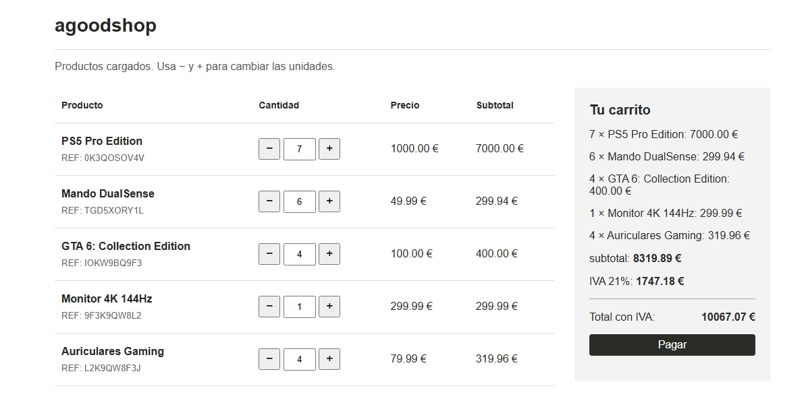

# Actividad 1: Carrito de la Compra

### Autor: **Kevin Flores**

## Asignatura: **Entorno Cliente_2ºDAW_UNIR**
## Curso: **2026/2027**

Aplicación web sencilla para practicar JavaScript, manipulación del DOM y peticiones `fetch`. 

Muestra productos, permite cambiar sus cantidades y calcula el subtotal, el IVA (21 %) y el total con IVA. 
El botón de pago simula la compra y vacía el carrito; no procesa pagos reales.

## Archivos principales

- `carrito/index.html`: estructura de la página; carga `app1.js`.
- `carrito/estilos.css`: estilo de la página.
- `carrito/app1.js`: lógica del carrito, actualización de la interfaz y petición a la API.
- `carrito/api.php`: API local que devuelve en JSON los cinco productos de ejemplo.

Los productos se cargan desde `api.php`.

## Prueba de funcionamiento

La siguiente captura muestra el carrito en funcionamiento, con productos, cantidades, subtotales, IVA 21% y el total con IVA:

